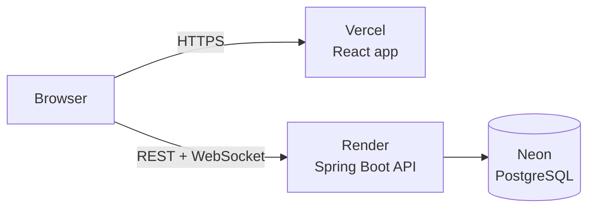

<p align="center">
  
</p>

<h1 align="center">ThriftBite</h1>

<h3 align="center">Tonight's surplus, saved before closing.</h3>

<p align="center">
  A marketplace for surplus food in Baguio. Bakeries and carinderias list end-of-day food at a discount;
  buyers reserve it, then pick it up and pay at the counter before it goes to waste.
</p>

<p align="center">
  <a href="https://thriftbite.vercel.app"><b>Try the live demo</b></a> ·
  <a href="docs/API.md">API</a> ·
  <a href="docs/DESIGN.md">How it works</a> ·
  <a href="docs/DEPLOY.md">Deploy</a>
</p>

<p align="center">
  <a href="https://github.com/malemanape/ThriftBite/actions/workflows/ci.yml"></a>
</p>

The demo has one-tap logins for a buyer, a store owner and an admin, with sample Baguio data that resets every 6 hours. It runs on free hosting, so the first load after a quiet spell can take about a minute while the server wakes up.

---

## What it does

| Who | What they can do |
| --- | --- |
| **Buyers** | Browse food for sale, soonest-expiring first. Reserve from several stores in one checkout and get a claim code per store, then pay at the counter. Follow stores to get an alert when they post, and see how much they've saved. |
| **Store owners** | List food with a photo and a pickup window, or use **Post again** to relist what usually sells, adjusted by how it went last week. Hand over pickups by checking claim codes, and see sales: money made, share sold, leftovers by weekday, pickups by hour. Add up to five staff logins for the counter. |
| **Admins** | Approve new stores, answer buyers' problem reports, and suspend accounts that break the rules. Every action goes into an activity log that can't be edited. |

## Built to hold up

- **Live stock.** When someone reserves, the count drops on every open screen over a WebSocket. Updates go out only after the database commits, so a checkout that fails announces nothing, and messages carry no private data.
- **All-or-nothing checkout.** A cart spanning several stores reserves everything or nothing, with one reservation and claim code per store. Stock comes off in one conditional update that only succeeds if enough is left, so two buyers can never both get the last item.
- **Accounts without email.** Signing up gives eight one-time recovery codes instead of a reset link. Changing a password logs out every other device at once.
- **Fair limits.** Reserving is free, so missed pickups pause reserving for a while, wrong claim codes and passwords are rate-limited, and none of it lets a stranger lock someone else out.
- **Safe photos.** Uploads are decoded and redrawn as JPEGs on the server, which drops location data and anything that isn't really a picture. It's sized to run in 512 MB.
- **Moderation that's honest.** Reports are checked against real pickups, the store never learns who reported it, and an admin can excuse an unfair missed pickup.

The details behind each of these are in [How it works](docs/DESIGN.md).

## Tech stack

| Layer | Technology |
|---|---|
| Backend | Java 21, Spring Boot 4 (Web MVC, Security, Data JPA, Validation, WebSocket) |
| Database | PostgreSQL 17, Flyway migrations |
| Frontend | React, TypeScript, Vite |
| Testing | JUnit 5, Testcontainers |
| CI | GitHub Actions |
| Hosting | Vercel (frontend), Render (API, Docker), Neon (Postgres), all in or near Singapore |



## Run it locally

**Requirements:** JDK 21+, Node.js 22+, Docker Desktop (running).

**Backend**: starts Postgres automatically through `backend/compose.yaml`.
```bash
cd backend
./mvnw spring-boot:run        # Windows PowerShell: .\mvnw spring-boot:run
```
The API runs at http://localhost:8080 (health check: `/actuator/health`).

To create an admin account locally, set these before starting (PowerShell):
```powershell
$env:APP_ADMIN_USERNAME = "admin"
$env:APP_ADMIN_PASSWORD = "<at-least-12-characters>"
```

To get the one-tap demo accounts (and a month of sample sales) locally, also set `$env:APP_DEMO_ENABLED = "true"` before starting the API. This wipes the local database's other accounts on startup.

**Frontend**
```bash
cd frontend
npm install
npm run dev                   # http://localhost:5173, talks to the API on :8080
```
The API address comes from `VITE_API_URL` (see [`frontend/.env.example`](frontend/.env.example)); without it the app uses `http://localhost:8080`.

**Tests**
```bash
cd backend
./mvnw verify                 # needs Docker for Testcontainers
```

## Deploy

The live demo runs on free tiers: Neon for Postgres, Render for the API ([`render.yaml`](render.yaml) sets it up as a Blueprint, deploying from `main` only after CI passes), and Vercel for the frontend. Step-by-step setup and the free-tier notes are in [Deploying ThriftBite](docs/DEPLOY.md).

## Project structure

```
backend/    Spring Boot API: one package per feature (auth, store, item, cart, reservation, live, admin, …)
frontend/   React + TypeScript app: one page per screen in src/pages
docs/       API reference, design notes and deploy guide
.github/    CI workflow
```

## Evolution

ThriftBite started as a Team 7 university project and was rebuilt from scratch as a web app.

| Version | Communication | Storage | Client |
|---|---|---|---|
| v1 ([`original-version`](../../tree/original-version), tag `v1.0`) | Raw TCP sockets, thread per client | XML files | Java Swing |
| v2 (`main`) | REST + WebSockets | PostgreSQL | React web app |

A version built on Java RMI lives in **thriftbite-rmi**.

## My role

**v2:** I rebuilt the whole project, backend and frontend, with AI-assisted development.

**v1 (Team 7, university project):** I was the backend developer. I built the socket server, the request handling for all 25 protocol actions, and the XML persistence layer.

## Credits

**Thryx**, ThriftBite's mascot, was designed by a teammate from the original Team 7. Thank you for creating him, and for letting him carry on into v2.
